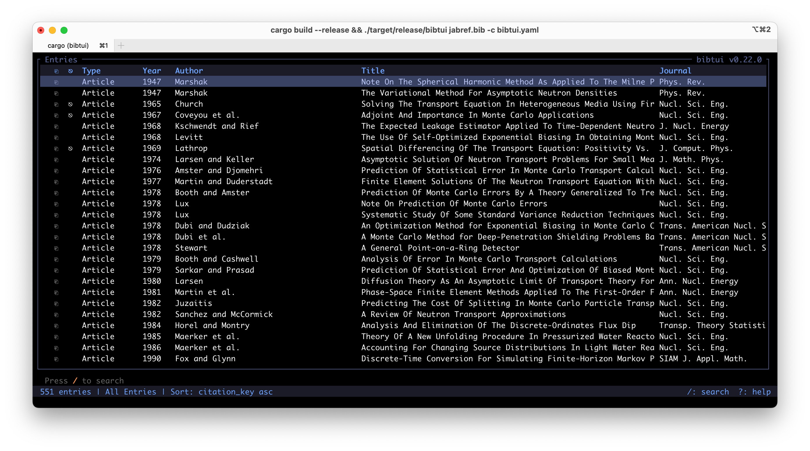

# bibtui

[](https://github.com/jkulesza/bibtui/actions/workflows/ci.yml)
[](https://codecov.io/gh/jkulesza/bibtui)

A terminal UI BibTeX manager written in Rust. Designed as a lightweight, keyboard-driven replacement for JabRef.



## Features

- Fast fuzzy search across all fields with field-specific syntax (`author:smith year:2020`)
- JabRef-compatible group tree (static and keyword groups)
- Byte-perfect BibTeX round-tripping — formatting is preserved for unmodified entries, including blank lines inside values, macros, and comments; in edited or rekeyed entries, unchanged fields keep their original form (`#` concatenation, `@String` references, quoted vs braced style); optional `field_order: alphabetical` sorts fields within required / optional / nonstandard subgroups on save
- Vim-style navigation throughout
- Entry CRUD: add, edit, duplicate, delete with undo (`u`); editing after undo correctly retains unsaved-change protection
- JabRef-compatible citation key patterns with three-level precedence (`.bib` metadata, YAML config, defaults)
- Per-library settings stored in the `.bib` file override the YAML config; JabRef-shared capabilities (key patterns, save order, save actions) use JabRef's own metadata keys, and everything else is kept as `bibtui.*` metadata that JabRef preserves
- Clipboard yank (`yy`) in configurable format: formatted citation, raw BibTeX, the attached file(s) themselves (paste them into an email as attachments), or citation key. The picker lists the choices you use most first and accepts `f` / `b` / `a` / `c` as shortcuts
- Per-entry status indicators: `●` unsaved change, `⎘` file attachment, `⎋` DOI/URL
- Open attached files (`o`) or DOI/URL links (`w`) with OS default applications
- Citation preview popup (`Space`) and formatted yank in a selectable style (`citation.style`, also in Settings): **IEEEtranN** (full IEEE reference with DOI/URL link) or **slidefooter** (terse author, venue, and year for presentation footers, e.g. `Smith et al., Phys. Rev. Lett. 12(3), 2020` or `Sokolowsky and Kulesza, LANL LA-UR-24-28595, 2024`)
- LaTeX markup rendered to Unicode for display (`L` to toggle)
- Assigned groups shown in the entry detail header alongside the entry type
- ISO 4 journal abbreviation: the Journal column always shows the abbreviated form; a save action syncs `journal_full` and `journal_abbrev` companion fields
- Configurable columns, sort, theme, citekey templates, and **keybinding overrides** via YAML
- Export entries to **CSL-JSON** (Zotero/Pandoc compatible) or **RIS** via `:export-json` / `:export-ris`. Exports (including settings exports) never write over the open `.bib` file or a link to it, ask before replacing an existing file, and are written atomically, so a failed export leaves any previous file intact
- In-TUI settings editor (`S`) with live config import/export, `Tab`-completion path dialogs, and field group management
- Validate command (`v`) dry-runs all save actions and shows which fields would change, without modifying the file
- Context-sensitive help modal (`?`): entry-list view shows navigation, search, command-palette, and **Quality** (C / M / U / v) keys in dedicated sections; detail view shows field editing and vim modal editor keys
- `F` in the detail view syncs the attached filename to the current citation key on demand, with undo support; partial failures keep successful paths accurate, and forward/undo renames never overwrite an existing destination
- Scrollable filename-sync preview dialog confirms file renames before they are applied
- Import entries from a DOI, URL, or local PDF file (`I` or `:import <doi-or-url-or-path>`): queries Crossref for metadata, with extensible publisher-specific scrapers (ANS, Taylor & Francis); automatically downloads an open-access PDF via Unpaywall when available; extracts DOI from local PDFs and sets the file attachment directly; citation key is generated immediately from the configured template
- Import books by ISBN-10 or ISBN-13 (`I` or `:import <isbn>`): fetches metadata from OpenLibrary; accepts any common notation (bare digits, hyphens, spaces, mixed); stores ISBN-13 when available, falls back to ISBN-10
- Per-file attachment management in the detail view: each attached file appears as its own navigable row; `e`/`Enter` edits the path, `f` adds a new attachment, `d` removes an individual file
- URL fields preserve percent-encoding (e.g. `%20`) on save
- Leading/trailing whitespace is stripped from every field value on save (`{University of Texas }` → `{University of Texas}`); disable with `save_action_trim_whitespace: false`
- **Duplicate detection and merging** (`U` or `:dups`): finds entries sharing a DOI, ISBN (ISBN-10 and -13 compare equal), eprint, or URL, or with near-identical titles (same year and first author); a field-by-field merge view resolves conflicts, combines groups and attached files, retargets `crossref`s, deletes the other copies, and reports the retired citation keys — all as one undoable step. "Not a duplicate" marks are stored in the `.bib`, and imports or new entries that match an existing one offer to merge instead (see [Duplicates](#duplicates-u))
- Duplicate citation keys are detected at load: later copies are renamed with the first `_dupN` suffix that no entry in the file already uses (persisted on the next save) and a startup warning lists the affected keys
- `w` fetches DOI/URL from Crossref via metadata (title, author, year) when none is present, in both the entry list and detail view; only sets `url` when it is distinct from the DOI; when multiple links are available (DOI, URL, ISBN) a picker dialog is shown. Each Crossref result is compared with the entry: a DOI is assigned without asking only when exactly one work has the same title (ignoring case, punctuation, LaTeX markup and a subtitle; at least 90% similar) and the same first author or year, with neither contradicting the entry. Several such works (for example two editions when the entry has no year), or only weaker matches, are listed in a picker to choose from or reject; when nothing is credible the closest result is named and the entry is left alone. The lookup runs in the background; its answer is applied only if the entry still has the same key, title, author, year, DOI and URL as when the lookup started (otherwise the status line shows the DOI it found and nothing changes), and the DOI and URL it sets undo as one step
- Background imports and DOI lookups never interrupt you: a result that arrives while a field editor, prompt, dialog, Settings or the duplicate review is open waits until you close it, then opens (or shows its error) as usual
- `w` opens an OpenLibrary search (`openlibrary.org/search?isbn=…`) for entries with an `isbn` field but no DOI or URL
- HTTPS imports explicitly use the native TLS connector and OS trust store on non-musl builds; musl builds use rustls with bundled webpki roots. Certificate and hostname verification remain enabled
- Import errors are shown in a full-screen popup so long messages (e.g. network errors) are never truncated; `yy` copies the error text to the clipboard

## Requirements

- Rust toolchain (1.88.0 or newer): https://rustup.rs

## Build

```sh
cargo build --release
```

The binary is placed at `target/release/bibtui`.

Optionally copy it to somewhere on your `$PATH`:

```sh
cp target/release/bibtui ~/.local/bin/
```

Pre-built binaries for Linux (static musl and RPM), macOS (Apple Silicon and Intel), and Windows are attached to each [GitHub release](https://github.com/jkulesza/bibtui/releases). macOS binaries are code-signed and notarized with an Apple Developer ID, so Gatekeeper will not block them.

**Clipboard support** (`yy`, `p` in the field editor, copying import errors): macOS uses the built-in `pbcopy`/`pbpaste` and Windows uses the system clipboard directly, so neither needs anything installed; on Windows, yanking attached files puts them on the clipboard the way Explorer's Copy does, ready to paste into a mail or a folder. Linux uses `wl-copy`/`wl-paste` (the `wl-clipboard` package) on Wayland and `xclip` or `xsel` on X11, for both text and files (`xsel` cannot copy files). If a clipboard tool is missing or fails, the status line says so instead of reporting a copy; an empty clipboard pastes nothing.

**Opening files and links** (`o`, `w`): macOS uses `open`, Linux `xdg-open` (from `xdg-utils`), and Windows the same mechanism as double-clicking in Explorer, so files open in their associated application and links in the default browser. The path or URL is passed as a single argument, never through a shell. If the opener reports a failure (for example, no application for that file type), the status line shows its message.

**Linux RPM** (Fedora / RHEL / openSUSE):

```sh
sudo rpm -i bibtui-<version>-linux-x86_64.rpm
```

## Usage

```
bibtui [OPTIONS] [BIB_FILE]

Arguments:
  [BIB_FILE]  Path to .bib file

Options:
  -c, --config <CONFIG>  Path to config file
  -h, --help             Print help
  -V, --version          Print version
```

If no file is given on the command line, bibtui looks for `bib_file` in the config file. A path that does not exist yet opens a blank library and the file is created on first save.

```sh
bibtui references.bib
bibtui --config ~/dotfiles/bibtui.yaml references.bib
```

## Keyboard Reference

Key release events are ignored. Holding a key repeats navigation and text
entry/deletion only; repeats never complete multi-key commands (`dd`, `gg`, …) or
repeat deletions, confirmations, or custom bindings.

### Entry List (Normal mode)

| Key | Action |
|-----|--------|
| `j` / `↓` | Move down |
| `k` / `↑` | Move up |
| `gg` | Jump to top |
| `G` | Jump to bottom |
| `Ctrl-F` / `Ctrl-B` | Page down / up |
| `Enter` | Open entry detail (list focus) / select group (sidebar focus) |
| `a` | Add new entry |
| `dd` | Delete selected entry. If it has attached files, choose which to delete too; a file another entry also uses starts unchecked and names that entry. Deleted files are removed permanently (undo restores only the entry), and any file that cannot be deleted is reported |
| `D` | Duplicate selected entry |
| `yy` | Yank to clipboard (see `general.yank_format`). In the picker, `f` formatted citation, `b` BibTeX entry, `a` associated file(s), `c` citation key |
| `/` | Start fuzzy search |
| `h` / `←` | Focus group sidebar (reveals it if hidden) |
| `l` / `→` | Focus entry list |
| `Tab` | Toggle group sidebar |
| `Space` | Citation preview popup (list focus) / select group (sidebar focus) |
| `o` | Open attached file(s) in OS default viewer |
| `w` | Open DOI / URL in default browser |
| `B` | Toggle case-protecting brace display |
| `L` | Toggle LaTeX rendering (accents, math, dashes) |
| `v` | Validate: dry-run save actions, show what would change |
| `U` | Find and merge duplicate entries (see [Duplicates](#duplicates-u)) |
| `I` | Import entry from DOI, URL, ISBN, or local PDF file |
| `S` | Open settings editor |
| `u` | Undo last change |
| `:` | Open command palette |
| `?` | Show full-screen help modal |
| `Esc` | Clear active search filter (if any); otherwise reset sort to configured default |

### Search mode

| Key | Action |
|-----|--------|
| Type | Append to search query |
| `Enter` | Confirm search / lock results |
| `Esc` | Clear search and exit |

Search syntax:
- Plain text — fuzzy match across all fields
- `field:query` — restrict to a specific field, e.g. `author:smith`, `year:2024`, `title:neural`
- Space-separated terms must all match, each with its own optional qualifier:
  `author:smith year:2020`
- `"double quotes"` match a contiguous phrase: `title:"neural methods"` (an unclosed
  quote takes the rest of the input, so typing works incrementally)
- Unknown qualifiers search custom fields; `key`/`citekey`/`citation_key` and
  `type`/`entrytype` are aliases; URLs and DOIs containing colons are literal text

While a search is active, text in the results that exactly matches it
(case-insensitively) is highlighted in the `search_match` theme color. The plain
words of the query are highlighted only as one whole phrase (`variance reduction`
highlights "variance reduction", not either word alone); each `field:` term is
highlighted separately, in that field's column only.

Search combines with the selected group (both filters apply). In libraries of more
than 500 entries, searches run in the background: the search bar shows
`searching…` and the current results stay visible until the new ones arrive.

### Entry Detail view

The detail header shows the entry type and its currently assigned groups.

| Key | Action |
|-----|--------|
| `j` / `k` | Move field selection |
| `gg` | Jump to first field |
| `G` | Jump to last field |
| `Ctrl-F` / `Ctrl-B` | Page down / up |
| `e` / `i` / `Enter` | Edit selected field (vim-style: `i` enters insert mode) |
| `A` | Add new field (names are letters, digits, `_` or `-`, stored lowercase) |
| `f` | Add file attachment |
| `F` | Sync attached filename(s) to current citation key (undoable) |
| `d` | Delete selected field |
| `T` | Convert selected field to title case |
| `t` | Change entry type (e.g. Article → InProceedings; undoable) |
| `a` | Normalize person-name fields (`author`, `editor`, etc.) to "Last, First" form; a brace-protected name such as `{National Aeronautics and Space Administration}` is one organization and is left as is |
| `o` | Open attached file(s) in OS default viewer |
| `w` | Open DOI / URL in default browser; if none exists, fetches DOI from metadata via Crossref |
| `Tab` | Edit entry's group assignments |
| `c` | Regenerate citation key from template |
| `B` | Toggle case-protecting brace display |
| `L` | Toggle LaTeX rendering |
| `u` | Undo last change |
| `/` | Start incremental field search |
| `n` / `N` | Jump to next / previous search match |
| `Esc` | Clear active search (first press); close detail and return to the list with that entry selected (second press) |

### Field editor (Editing mode)

The field editor uses vim-style modal editing. Opening a non-empty field starts in **Normal mode**; opening an empty field starts directly in **Insert mode**. The title bar shows `— INSERT` or `— REPLACE` when in those modes. Empty `title` / `booktitle` fields are pre-filled with `{}` and the cursor is placed inside the braces so case-protection is applied automatically.

#### Normal mode

| Key | Action |
|-----|--------|
| `i` | Enter Insert mode at cursor |
| `a` | Enter Insert mode after cursor |
| `A` | Enter Insert mode at end of line |
| `I` | Enter Insert mode at start of line |
| `R` | Enter Replace mode (overwrites characters; Backspace undoes one char at a time) |
| `h` / `←` | Move cursor left |
| `l` / `→` | Move cursor right |
| `0` / `Home` | Jump to start |
| `$` / `End` | Jump to end |
| `w` / `W` | Move to start of next word / WORD |
| `b` / `B` | Move to start of current/previous word / WORD |
| `e` / `E` | Move to end of current/next word / WORD |
| `f{c}` | Find next occurrence of character `c` (cursor lands on `c`) |
| `F{c}` | Find previous occurrence of character `c` (cursor lands on `c`) |
| `t{c}` | Move cursor to char just before next occurrence of `c` |
| `T{c}` | Move cursor to char just after previous occurrence of `c` |
| `j` / `↓` | Save edit and move to next field |
| `k` / `↑` | Save edit and move to previous field |
| `x` | Delete character under cursor |
| `X` | Delete character before cursor |
| `dw` | Delete to start of next word |
| `dt{c}` | Delete from cursor to (not including) next `c` |
| `df{c}` | Delete from cursor through (including) next `c` |
| `dT{c}` | Delete from (not including) previous `c` back to cursor |
| `dF{c}` | Delete from (including) previous `c` back to cursor |
| `D` | Delete to end of line |
| `C` | Change to end of line (delete + enter Insert mode) |
| `s` | Substitute character (delete + enter Insert mode) |
| `S` | Substitute entire field (clear + enter Insert mode) |
| `r{c}` | Replace character under cursor with `c` |
| `~` | Toggle case of character under cursor |
| `p` | Put (paste) from unnamed register after cursor |
| `yy` | Yank entire field value to unnamed register and system clipboard |
| `u` | Undo last change |
| `Enter` | Confirm edit |
| `Esc` | Cancel edit |

#### Insert mode

| Key | Action |
|-----|--------|
| Type | Insert character |
| `←` / `→` | Move cursor |
| `Ctrl-A` / `Home` | Jump to start |
| `Ctrl-E` / `End` | Jump to end |
| `Backspace` / `Delete` | Delete character |
| `Ctrl-W` | Delete word before cursor |
| `Ctrl-U` | Delete to start of line |
| `Tab` / `Shift-Tab` | Cycle forward / backward through completions |
| `Enter` | Confirm edit |
| `Esc` | Return to Normal mode |

Operations that delete text (`x`, `dw`, `dt{c}`, `df{c}`, `dT{c}`, `dF{c}`, `D`, `s`, `S`, `Ctrl-W`, `Ctrl-U`) save the deleted text to the unnamed register so it can be restored with `p`. Entering Insert mode via `i`/`a`/`A`/`I` snapshots the field value for undo with `u`. In Replace mode (`R`) each overwritten character is individually reversible with `Backspace`.

Long values scroll horizontally; `<` and `>` at the edges indicate hidden text.  The cursor is kept near the visual midpoint: it moves freely between the nearest edge and the centre, then the text scrolls while the cursor stays fixed at the centre.

**Month field selector:** editing a `month` field shows a visual 2×6 grid of the
standard BibTeX abbreviations (`jan`–`dec`). Use `←`/`→` to step one month,
`↑`/`↓` to jump between rows, or type a prefix (with ghost-text autocomplete) and
press `Tab` to cycle through matches. Any recognized form (`january`, `1`, `Jan`, etc.)
is normalized to the three-letter abbreviation on save.

Path dialogs (settings export/import, import entry, and export dialogs) support `Tab`
completion: the first press fills the longest common prefix of all matches; subsequent
presses cycle through candidates. Leading `~` is expanded to the home directory.

### Duplicates (`U`)

`U` (or `:dups`) lists clusters of possible duplicates. Two entries match when
they share a normalized **DOI**, **ISBN** (ISBN-10 and ISBN-13 compare equal),
**eprint**, or **URL**, or when their normalized titles (LaTeX rendered, braces,
case, and punctuation ignored) are at least `duplicates.title_threshold` similar
and the year and first-author surname agree (each check can be turned off).
Differing DOIs, ISBNs, eprints, editions, volumes, or report numbers mark
distinct works and never match; chapters of one book sharing its ISBN do not
match either. Matches chain, so A~B and B~C form one cluster, unless that
would put two entries you marked **not duplicates**, or two of those distinct
works, in one cluster: every cluster is safe to merge as a whole. Matches are
joined strongest first (DOI, eprint, ISBN, URL, then title similarity), and a
match kept out is listed under the cluster as `not merged: C ~ B (same DOI) —
kept apart: A and C are marked not duplicates`, for you to look at separately.

| Key | Review list |
|-----|-------------|
| `j` / `k`, `g` / `G`, `Ctrl-F` / `Ctrl-B` | Move between clusters |
| `Enter` | Reconcile the cluster in the merge view |
| `x` | Mark the cluster as **not duplicates** (stored in the `.bib`; undoable) |
| `Esc` / `q` | Close |

The merge view shows every field: identical ones (`✓`), ones only some entries
have (`+`, kept), and conflicts, where you pick the value to keep. `groups` and
`file` are combined across entries (`∪`), dropping repeated paths. The entry
with the most fields is kept by default; the others are deleted.

| Key | Merge view |
|-----|------------|
| `j` / `k` | Next / previous conflict |
| `h` / `l`, `1`–`9` | Keep the previous / next / Nth entry's value |
| `Tab` | Keep the next entry instead (its citation key and file position) |
| `c` | Regenerate the citation key from the template and merged fields |
| `Enter` | Merge (one `u` undoes the whole merge) |
| `Esc` / `q` | Back to the review list |

After a merge, `crossref` fields pointing at a retired key are updated and a
popup lists the retired keys as `old → new`; `yy` copies the list so you can
update your `.tex` sources.

When an imported entry (or one added with `a`, once its detail view closes)
matches an existing entry, bibtui offers to merge it, keep both (marking them
as not duplicates), or discard it. When a file is opened, the status bar
reports how many possible duplicate clusters it has.

"Not duplicates" marks are stored as
a JabRef metadata comment with one set of keys per line, which JabRef keeps:

```bibtex
@Comment{jabref-meta: bibtuiNotDuplicates:
keyA,keyB;
keyC,keyD,keyE;
}
```

The marks follow citation-key changes: regenerating one key (`c`), all keys,
or keys at save time, and renaming the surviving entry of a merge, update
them together with `crossref` fields, in the same undo step. Merged-away keys
are replaced by the surviving key, and a mark between entries that are later
merged into one is dropped. Marks on a deleted entry are kept, so undoing the
deletion restores them.

### Settings editor (`S`)

Opens a full-screen view of all configuration options. Changes apply immediately to the running session.

| Key | Action |
|-----|--------|
| `j` / `k` | Navigate settings |
| `g` / `G` | Jump to top / bottom |
| `Ctrl-F` / `Ctrl-B` | Page down / up |
| `Enter` / `Space` | Toggle boolean setting |
| `e` | Edit string setting / edit fields of selected field group |
| `r` | Rename selected field group |
| `a` | Add new field group |
| `x` | Delete selected field group |
| `E` | Export the YAML layer of the config to a YAML file (path dialog with `Tab` completion); settings stored in the library are not included |
| `B` | Write settings into the library's `.bib` file, after previewing the exact changes (see [Library settings](#library-settings-stored-in-the-bib)) |
| `I` | Import config from a YAML file (path dialog with `Tab` completion); library settings still take precedence |
| `Esc` | Close settings |

Settings marked with `●` differ from their default value; settings marked with
`◆` come from the library's `.bib` file and override the YAML config. Changing a
`◆` setting updates the library (an undoable edit, saved with `:w`); changing
any other setting changes the session's YAML layer, which `E` exports.

### Command palette

Open with `:` from the entry list.

| Command | Description |
|---------|-------------|
| `:w` / `:write` / `:save` | Save the file |
| `:w!` / `:write!` | Save even if the file changed outside bibtui (external version kept in `.bib.bak`) |
| `:wq` | Save and quit |
| `:wq!` | Force-save and quit |
| `:q` | Quit (confirmation dialog if unsaved changes) |
| `:q!` | Force quit without saving |
| `:sort <field>` | Sort by field (repeat to toggle direction) |
| `:sort none` | Clear sort and restore file order |
| `:sort` | Toggle sort direction |
| `:dups` / `:duplicates` | Find and merge duplicate entries (same as `U`) |
| `:group <name>` | Filter to a named group |
| `:search <query>` | Apply a search query |
| `:import <doi-or-url-or-path>` | Import entry from DOI, URL, or local PDF file |
| `:export-json [path]` | Export all entries as CSL-JSON (prompts for path if omitted) |
| `:export-ris [path]` | Export all entries as RIS (prompts for path if omitted) |
| `:settings-export bib` | Write settings into the library's `.bib` file (same as `B` in Settings) |
| `:settings-export yaml [path]` | Export the YAML layer of the config (prompts for path if omitted) |
| `:settings-clear-bib` | Remove all bibtui settings from the library; JabRef's own keys are kept (undoable) |

Example: `:sort year`, `:sort author`, `:sort title`, `:sort citation_key`, `:sort none`

`year`, `volume`, `number`, and `pages` (leading page number) sort numerically; all
other fields sort as text, even when some values contain only digits.

Sorting keeps an active group filter in place — `:sort` re-applies the filter to the
newly sorted list instead of falling back to all entries. If the sort field isn't one
of the configured columns, its values are shown in a temporary column on the right so
the sort is visually confirmable; the column disappears again once the sort changes to
a visible field or is cleared.

#### Saving

When `save.sync_filenames` is enabled, saving with `:w` or `:wq` shows a scrollable
preview of any file renames that will be performed, with `[y]es` / `[n]o` to proceed
or cancel. The preview is built from the final normalized fields and generated keys,
and confirming executes exactly that plan. Attachments that are missing from disk,
remote links (`https://…`), and files that another entry also references (including
through a symlink or hard link) are never renamed; the save completes and the status
line lists them. `F` (one entry in the detail view, every entry from the list) and its
preview follow the same rules, so a shared file is never moved out from under another entry.
Case-only renames (`smith2020.pdf` → `Smith2020.pdf`) work on
case-insensitive filesystems. A rename never overwrites an existing file, and
occupied destinations are reported before any file is moved.
If saving fails, completed attachment moves are reversed.

A failed save keeps the application open and the library marked unsaved, including
with `:wq`; correct the error and retry. Before anything is written, the new file
contents are parsed back and must reproduce every entry's key and field values; if an
entry would be lost or changed on reload, the save is refused and names the entry and
field. Field edits are checked as you confirm them: a value with unbalanced braces or
a trailing unescaped backslash, or a new field name with characters other than
letters, digits, `_` and `-`, is refused and the editor stays open with your text.
New field names are stored lowercase, as BibTeX reads them. Saves write an exclusive temporary file in
the destination directory, keep the existing file's permissions (new files get
normal permissions for your umask), and follow symlinks without replacing the link.

If the bibliography changed outside bibtui since it was loaded or last saved, `:w`
is refused and neither the file nor its backup is touched. Reload the file, or use
`:w!` to overwrite it; the external version is first copied to `.bib.bak` even when
`backup_on_save` is off. This is a check, not a lock against another program writing
at the same moment.

Undo works across saves: restored entries and citation keys are written on the next
save. Citation keys regenerated during save form a single undo step, and key changes
also update matching `crossref` fields (exact, case-sensitive matches) in that step.
Documents outside the library that cite old keys must be updated separately; disable
`save_action_regenerate_citekeys` to keep existing keys on save.

### Group tree

| Key | Action |
|-----|--------|
| `j` / `k` | Move selection |
| `Enter` / `Space` | Apply selected group filter (again to clear it) |
| `a` | Add a static group under the selected group |
| `e` | Rename the selected group (prompt pre-filled with its name) |
| `dd` | Delete the selected group (optionally removing it from its entries) |
| `u` | Undo |
| `h` / `l` | Switch focus between groups and entry list |

In the entry detail view, `Tab` opens a checklist to assign the entry to groups.
`?` lists these keys in a Groups section.

Renaming a static group also renames it in the `groups` field of every member
entry, because that is how JabRef records membership; only the name is replaced,
so each field keeps its separators and spacing. Renaming a keyword group changes
only its name. The rename is one undoable step, and JabRef-only group details
(color, icon, description) are kept. Names cannot contain `,` (JabRef's
separator in the `groups` field) or `;` and `\` (separators in its group
metadata), and cannot repeat another group's name. If two static groups share a
name and entries are assigned to it, there is no telling which group those entries
belong to, so bibtui refuses to rename either one; delete one of them with `dd`
(answering "no" to removing its memberships) or rename it in JabRef first.

The group sidebar can be hidden with `Tab` and revealed again with `Tab` or `h` / `←`.
The `display.show_groups` config option controls whether it is visible on startup.
Groups are tracked by their position in the tree, so two groups with the same name
in different subtrees filter independently.

## Configuration

bibtui looks for a config file in this order:

1. Path given with `--config`
2. `./bibtui.yaml` or `./bibtui.yml` (next to the working directory)
3. `$XDG_CONFIG_HOME/bibtui/config.yaml` (typically `~/.config/bibtui/config.yaml`)

If no file is found, built-in defaults are used.

Copy the annotated example to get started:

```sh
cp bibtui.yaml.example ~/.config/bibtui/config.yaml
```

### Library settings (stored in the `.bib`)

A library can carry its own settings, so it behaves the same on every machine
and for every collaborator. Precedence is: built-in defaults < YAML config <
library. Settings are stored as JabRef metadata comments, so JabRef keeps them
when it saves the file:

| Setting | Stored as |
|---|---|
| Citation-key templates | JabRef's `keypattern_<type>` (also used by JabRef) |
| Entry order on save (`save.entry_sort_order`) | JabRef's `saveOrderConfig` |
| Save actions JabRef also has: Unicode→LaTeX, escape `_`/`&`, LaTeX cleanup, URL cleanup, ordinals, date/month/page/name normalization | JabRef's `saveActions` (JabRef applies them too) |
| Everything else | `@Comment{jabref-meta: bibtui.<setting>:<value>;}` |

Press `B` in Settings (or run `:settings-export bib`) to write settings into the
library. A preview lists every metadata line that will be added (`+`), changed
(`~`), or removed (`-`); nothing changes until you confirm, and the result is an
ordinary undoable edit saved with `:w`. bibtui writes the settings that differ
from its built-in defaults, plus any the library already stores.
`:settings-clear-bib` removes bibtui's own keys and leaves JabRef's alone.

Notes:

- A library that already has JabRef `saveActions` or `saveOrderConfig`
  (for example JabRef's defaults, which only normalize dates, months, and
  pages) overrides the corresponding YAML settings; these are marked ◆ in
  Settings. Turn an action back on there to rewrite `saveActions` for both programs.
- If JabRef's `saveActions` use formatters bibtui does not have, or its
  `saveOrderConfig` sorts by other fields, bibtui reads what it can and never
  rewrites them.
- `general.bib_file` cannot be stored in a library.
- `bibtui.*` values are one-line JSON. A bare word (`alphabetical`) is read as a
  string; invalid values are reported at startup and ignored.

### Key config options

```yaml
general:
  bib_file: ~/documents/references.bib   # default file when none given on CLI
  backup_on_save: true                    # write .bib.bak before every save
  yank_format: prompt                     # citation_key | bibtex | formatted | file | prompt
                                          #   citation_key — bare key (e.g. Smith2020)
                                          #   bibtex       — raw @Article{...} block
                                          #   formatted    — citation in citation.style
                                          #   file         — the attached file(s), pasteable
                                          #                  as email attachments
                                          #   prompt       — picker dialog each time, most-used
                                          #                  choice first (counts kept in
                                          #                  <state dir>/bibtui/usage.yaml)

display:
  show_groups: true                       # show group sidebar on startup
  group_sidebar_width: 30
  show_braces: false                      # show/hide case-protecting {braces}; toggle with B
  render_latex: true                      # render LaTeX → Unicode for display; toggle with L
  abbreviate_authors: true                # abbreviate author lists in entry list
  journal_field_content: full             # what the journal field holds after the
                                          # abbreviate_journal save action:
                                          #   full        — full journal name
                                          #   abbreviated — ISO 4 abbreviation
                                          # (the Journal column always shows the
                                          #  abbreviated form regardless of this setting)
  default_sort:
    field: citation_key
    ascending: true

save:
  align_fields: true                      # align field values to a column on save
  field_order: jabref                     # jabref (default) | alphabetical
                                          # jabref preserves original field order;
                                          # alphabetical sorts within required / optional /
                                          # nonstandard subgroups on every save
  sync_filenames: false                   # rename attached files to match citation key on save
                                          # (preview dialog shown before applying)
  save_action_trim_whitespace: true       # strip leading/trailing whitespace from every field
                                          # value ({University of Texas } → {University of Texas})
  save_action_abbreviate_journal: false   # populate journal_abbrev (ISO 4) and journal_full
                                          # companion fields on save; rewrite journal per
                                          # journal_field_content (display/settings)

citation:
  style: IEEEtranN                       # IEEEtranN | slidefooter (terse, for slide footers)

titlecase:
  ignore_words: [MCNP, OpenMC]           # words kept verbatim by the T title-case command

duplicates:                               # duplicate detection (U / :dups)
  title_threshold: 0.9                    # min title similarity (0.0–1.0) without a shared
                                          # DOI / ISBN / eprint / URL
  require_same_year: true                 # title matches also need the same year
  require_same_author: true               # ...and the same first-author surname
  check_on_load: true                     # status-bar note when a file is opened
  check_on_import: true                   # offer to merge an imported / added duplicate

theme:                                    # each color is "#rrggbb"; invalid ones warn and use the default
  selected_bg: "#3b4261"
  selected_fg: "#c0caf5"
  header_bg:   "#1a1b26"
  header_fg:   "#7aa2f7"
  search_match: "#ff9e64"
  border_color: "#565f89"
```

```yaml
# Custom field groups in the detail view (fields pulled out of the "Other" section)
field_groups:
  - name: Identifiers
    fields: [isbn, issn, lccn, eprint, archiveprefix, primaryclass]
```

```yaml
# Override or add keybindings on a per-mode basis
keybindings:
  normal:
    "ctrl-n": "AddEntry"      # add entry with Ctrl-N
    "ctrl-d": "DeleteEntry"   # delete with Ctrl-D
    "J":      "ExportJson"    # export CSL-JSON
    "R":      "ExportRis"     # export RIS
  detail:
    "ctrl-r": "RegenCitekey"  # regenerate citekey
```

Supported modes: `normal`, `detail`, `search`, `editing`, `settings`, `citation_preview`, `dialog`, `command`, `name_disambig`, `dedup_review`, `dedup_merge`.
Use `"None"` as the action to intentionally unbind a key.

See `bibtui.yaml.example` for all options including columns, citekey templates, save normalization, and a full keybinding reference.

## Import

Press `I` from the entry list (or run `:import` from the command palette) to import an entry. The input accepts:

- **Bare DOI** — `10.1080/00295639.2025.2483123`
- **DOI URL** — `https://doi.org/10.1080/...` or `http://dx.doi.org/10.1080/...`
- **Publisher URL** — e.g. `https://www.tandfonline.com/doi/abs/10.1080/...` or `https://www.ans.org/pubs/...`
- **Local PDF file** — `/path/to/paper.pdf` or a relative path; `Tab` completes filesystem paths

The import pipeline (in priority order):

1. **PdfFetcher** — for local `.pdf` files: scans the first 200 KB and last 50 KB of raw bytes for a DOI (labeled patterns like `doi:`, `doi.org/`, XMP `prism:doi`, and bare `10.XXXX/...` patterns), then looks up the DOI via Crossref. The PDF path is set as the file attachment directly — no download needed.
2. **AnsFetcher** — for `ans.org` article URLs: scrapes the page for metadata and PDF URL candidates.
3. **TandFOnlineFetcher** — for `tandfonline.com` URLs: extracts the DOI from the URL path or page metadata.
4. **CrossrefFetcher** — general fallback for any bare DOI or `doi.org` URL.

After metadata is fetched, the pipeline:
- Corrects the `publisher` field when Crossref reports a distributor instead of the society publisher (e.g. ANS journals distributed by Taylor & Francis are corrected to "American Nuclear Society", identified by DOI prefix `10.13182/`, ISSN, or journal name).
- Queries [Unpaywall](https://unpaywall.org/) for a legal open-access PDF URL and, if found, prepends it to the download candidate list.

PDF candidates are tried in order (Unpaywall OA → publisher PDF → ANS direct → T&F PDF) until one succeeds. The `file` field is written as a relative path from the JabRef `fileDirectory` when that metadata is present, with `:` and `;` escaped as JabRef expects (including Windows drive letters).

Network limits: metadata requests have a 5-second connect, 10-second read, and
30-second total timeout, the whole metadata phase of an import is limited to 90
seconds, and metadata responses are capped at 4 MiB. The optional Unpaywall lookup
has 5 seconds and is skipped for local PDFs. PDF downloads are not subject to those
budgets: they stop only if the connection stalls for 10 seconds, exceed 10 minutes,
or exceed `import.max_pdf_size_mb` (default 100).

Downloads are streamed to a temporary file, checked for the `%PDF` signature, and
then given their final name. Re-importing a DOI reuses an identical earlier download;
if a different file already has that name, the new one is saved as `<doi>_2.pdf`
(and so on), so existing files are never overwritten. A failed download keeps the
imported metadata and reports the error. For local PDFs, DOI detection reads only the
first 200 KB and last 50 KB of the file.

## Running Tests

```sh
cargo test
```

Run `cargo test --locked` for the complete suite. CI runs native tests on Linux,
macOS, and Windows and checks the minimum compiler, Rust 1.88.0. Formatting and
strict Clippy use Rust 1.93.1. Coverage uses the same fixed compiler and
cargo-llvm-cov 0.8.4; `scripts/check_coverage.py` checks the checked-in overall and
application-module floors in `coverage-baseline.json`. Baseline changes require an
explicit edit with an explanation. `cargo llvm-cov report --summary-only` displays
an existing report without rerunning tests. See the
[review implementation report](review/IMPLEMENTATION.md) for all 19 completed
items, measured coverage, before/after performance, reproducible probes, and
remaining platform-validation limits.

The suite drives real keyboard and paste events through edit/save/undo workflows,
uses temporary directories for config and library fixtures, and makes no requests
to public services. Format with `cargo fmt --all` (CI runs
`cargo fmt --all -- --check`). Repository-wide formatting commits are listed in
`.git-blame-ignore-revs`; enable it locally with
`git config blame.ignoreRevsFile .git-blame-ignore-revs`.

Coverage analysis runs automatically in CI via `cargo-llvm-cov`. To run locally:

```sh
cargo llvm-cov --workspace --summary-only
```

## Changelog

See [CHANGELOG.md](CHANGELOG.md) for the full release history.
